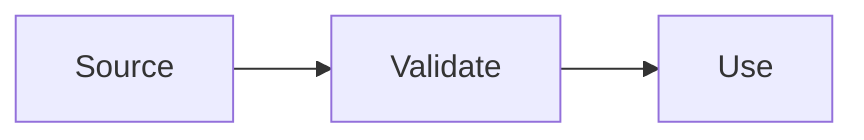

# Architecture

Where code goes and how data moves. Describes the intended design; read the code for what exists.

## Stack and entry points

<!-- FILL: framework, language, runtime, and the files where the app starts (router, server entry, config). -->

| Concern | Choice | Reason |
| --- | --- | --- |
| `<concern: what the choice covers, e.g. framework>` | `<choice: what was chosen>` | `<reason: the owner's stated reason; do not invent one>` |

## Routes or modules

<!-- FILL: the planned pages, endpoints, or modules. A Mermaid diagram helps. -->

## Data flow

<!-- FILL: where data comes from, how it is validated, and how it reaches the UI or caller. -->

## Folder ownership

<!-- FILL: what each top-level folder owns, and the rule for where new code goes. -->

| Path | Owns |
| --- | --- |
| `src/` | `<owns: what lives here and what does not>` |
| `tests/` | `<owns: what lives here and how it mirrors src/>` |
