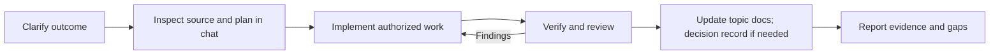
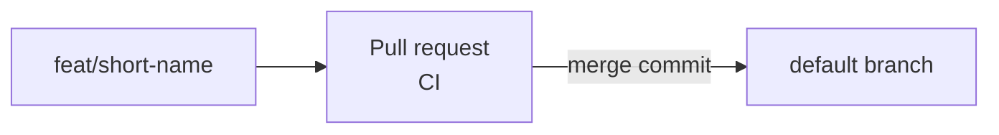

# Development workflow

The owner sets direction and authorizes work; agents inspect source, plan in chat, implement, and verify. Claude Code and Codex share [../AGENTS.md](../AGENTS.md) directly.

## Sources of truth

| Information | Home | Purpose |
| --- | --- | --- |
| Product direction | [intent.md](intent.md) | Goals, non-goals, answered and open questions |
| Conventions and plans | Topic docs in [README.md](README.md) | Architecture, data, UI, and development rules |
| Architectural rationale | [decisions/](decisions/README.md) | Significant technical choices, alternatives, and consequences |
| Current behavior | The source code | What is implemented today |
| Task scope and plan | The issue (if one exists) and the current chat | Requested outcome, acceptance criteria, files, steps, risks |
| Verification | Pull request description and CI | Actual results, existing failures, regressions, and limitations |

A decision record explains why an architectural choice was made; it does not replace a feature's requirements or proof that the feature works. Docs do not track implementation status. Update them when a convention, plan, or decision changes, and preserve actual owner decisions. Chat plans are less durable than versioned ones; carry important outcomes into the issue or pull request.

## Working on a task



1. **Clarify:** read the product intent and relevant docs. Establish the outcome, scope, constraints, and observable acceptance criteria. Resolve consequential questions before dependent work.
2. **Plan:** for substantial work, inspect source and prepare a plan in chat before implementing. Name files, steps, risks, and checks. Include code examples and diagrams where useful. Tiny reversible edits need only a clear task description and appropriate verification.
3. **Implement:** follow actual owner authorization. Once authorized, continue routine work within scope without repeated permission questions. Seek a decision when missing information, a consequential scope change, or an existing restriction requires it. Update the plan when the approach changes.
4. **Verify and review:** run appropriate checks, inspect the diff, and compare behavior with acceptance criteria. Fix new findings without weakening checks. Report actual results and remaining gaps.
5. **Document:** update affected topic docs when a convention or plan changes. Add or update a [decision record](decisions/README.md) for choices such as stack, data model, authentication approach, rendering strategy, or deployment host. Ordinary feature edits and bug fixes do not automatically need one. Product decisions from the owner go in [intent.md](intent.md) as dated answers.
6. **Deploy and maintain:** when deployment is authorized and configured, record the target, startup, smoke checks, and recovery approach. Local verification does not establish deployed behavior. Reported bugs and operational findings become new tasks.

## Git workflow

Trunk-based, through pull requests.



1. **Branch** from the default branch as `<type>/<short-name>`: `feat/navbar-links`, `fix/login-cookie`, `docs/git-workflow`.
2. **Commit** with conventional commits (`feat:`, `fix:`, `refactor:`, `docs:`, `ci:`, `chore:`, `test:`).
3. **Open a PR** whose title is a conventional commit. In the description, say what changed, how it was tested, and what was not checked. Link the issue if there is one.
4. **CI** runs `verify` and must pass.
5. **The owner merges.**

Never rename a branch that has an open PR; GitHub closes the PR. For a change that depends on an open PR, base the new branch on that PR's branch, then rebase onto the default branch after it merges.

## Acceptance and completion

Owner authorization comes from an actual instruction; an agent-written status cannot supply it. The owner's latest instruction takes precedence over an older plan.

Report a task complete only when its own requirements have evidence. Failed required checks remain failed even if the cause predates the task. Distinguish scoped completion from a clean baseline, and local verification from deployment. In the completion report include what changed, checks and results, existing failures versus new findings, and anything not checked.

These documents guide behavior; they do not enforce tool permissions. CI is the enforcement point ([development.md](development.md#ci)).

## Verification by change type

| Change | Evidence to select |
| --- | --- |
| Documentation | Source accuracy, relative links, consistency across instructions and topic docs |
| Tooling/configuration | Relevant lint/format checks, real command execution, failure behavior where applicable |
| Code | `verify`, including tests for the changed behavior; affected screens or flows |
| Behavioral bug fix | Reproduce with a failing test, then fix it so the test passes |
| Data or content | Relevant tests, validation command, reviewed boundaries |
| Deployment | Build, configured startup, target smoke checks, recovery procedure |

The full command list lives in [development.md](development.md#available-scripts). Take a fresh baseline when a comparison is needed. Keep output concise and never include secrets or `.env` contents.

## Example task prompt

```text
Read AGENTS.md, docs/README.md, docs/intent.md, and docs/workflow.md.
Inspect the source for <area> and plan the work in chat.
State the scope, acceptance criteria, files, steps, risks, and checks.
Include code examples and diagrams where useful.
```
